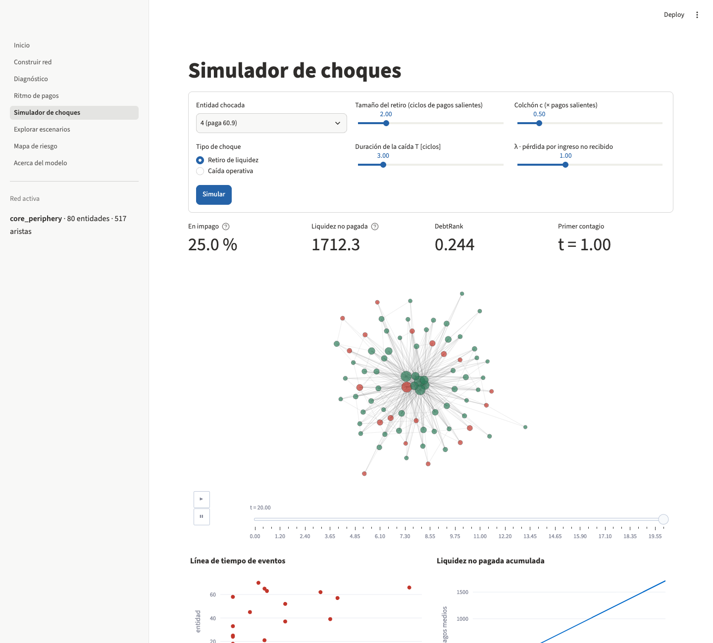
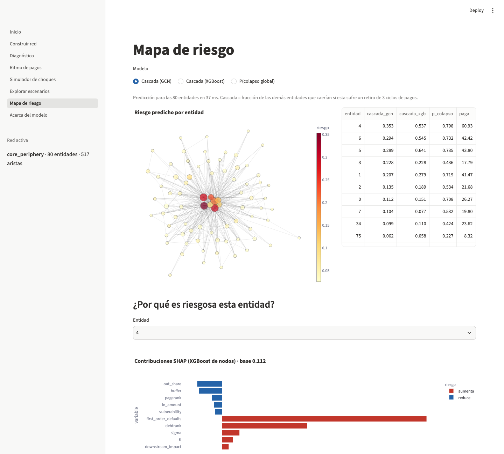

# finnet · redes complejas, sincronización y riesgo en sistemas de pagos digitales

Modelo físico-matemático y app web para estudiar propagación, sincronización
colectiva y eventos críticos en redes de pagos digitales. Un solo sistema dinámico,
construido en capas (tareas 1–5 de la propuesta), y su aplicación al **riesgo
crediticio de la cartera de un banco** (Tarea 6): clientes como osciladores cuyos
ciclos de pago se sincronizan, y una pregunta medible:

> ¿La **dinámica** de la red de pagos de los clientes (sincronía de sus ciclos)
> aporta información de impago que ni el score clásico ni las variables **estáticas**
> de red capturan?

> Parámetros **ilustrativos**, no calibrados con datos reales. Bre-B (el sistema de
> pagos inmediatos de Colombia) aparece solo como escenario de ejemplo.





## El modelo (tareas 1–5)

$$
\frac{dx_i}{dt} = -\alpha x_i + \beta\sum_j W_{ij}x_j - D_0(Lx)_i + \gamma\,k_i(1-r_i) + \eta_i(t)
$$

$$
\frac{d\theta_i}{dt} = \omega_i + \frac{K}{\langle k\rangle}\sum_j W_{ij}\sin(\theta_j-\theta_i),
\qquad x_i > x_i^{(c)} \Rightarrow \text{impago: } W_{\cdot i}\leftarrow 0
$$

| Tarea de la propuesta | Término | Indicador | Página de la app |
|---|---|---|---|
| 1 · Red y estrés nodal | $-\alpha x + \beta W x$ | $R = \beta\rho(W)/\alpha$ | Construir red, Diagnóstico |
| 2 · Difusión y estabilidad | $-D_0 L x$, $L = D_\text{out}-W$ | $\sigma$, $\tau_\text{rec}$, $\lambda_2$ | Diagnóstico |
| 3 · Sincronización | Kuramoto + $\gamma k_i(1-r_i)$ | $r$, $r_i$ | Ritmo de pagos |
| 4 · Cascadas de impago | umbral $x_i^{(c)}$, Watts, DebtRank, Eisenberg–Noe | % en impago | Simulador de choques |
| 5 · Predicción | logística, XGBoost, GCN, SHAP, PINN | ROC-AUC, Spearman | Explorar escenarios, Mapa de riesgo |
| **6 · Riesgo crediticio híbrido** | red multicapa de clientes | ΔAUC pareado | **Cartera multicapa, Riesgo crediticio híbrido** |

Dos diferencias deliberadas con la propuesta, por consistencia dimensional: el
acople de Kuramoto se normaliza por $\langle k\rangle$ en lugar de $N$ (en redes
dispersas $K/N$ hace desaparecer el acople; es la forma de Rodrigues et al., 2016) y
el término $\gamma k_i(1-r_i)$ une las capas: la desincronización crea déficit.

Convenciones: `W[i, j]` es el pago **de j hacia i**; en las tareas 1–5 el tiempo se
mide en ciclos de pago (1 = un día hábil) y el dinero en "pagos medios por ciclo".

## Tarea 6 · Riesgo crediticio híbrido en una red multicapa

**Mundo** (`finnet.world`, `configs/world.yaml`): 2000 personas y 100 firmas
clientes de un mismo banco, con 55 % de informalidad. Tres capas de pagos: **nómina**
(firma → empleado), **proveedores** (firma → firma) y **transferencias** (persona →
persona). Cada cliente tiene variables clásicas (ingreso, endeudamiento, moras,
antigüedad…) y una PD anual idiosincrática verdadera que ningún modelo ve
(`truth_*`, vetadas por esquema).

**Dinámica** (motor de las tareas 1–4 generalizado; 1 ciclo = 1 mes, $x$ como fracción
del ingreso total $s_i$):

$$
\dot x_i = -\alpha x_i + \sum_\ell \beta_\ell \sum_j \frac{W^\ell_{ij}}{s_i}x_j
  + \gamma\frac{k_i}{s_i}(1-r_i) + \sigma\xi_i,\qquad
\dot\theta_i = \omega_i + \sum_\ell K_\ell\sum_j\frac{W^\ell_{ij}}{k_i}\sin(\theta_j-\theta_i)
$$

Colchón $x_i^{(c)} \propto \mathrm{PD}_i^{-\kappa}$, impagos idiosincráticos programados
y quiebra de un empleador como choque.

**Lo que ve el banco**: un registro de transacciones (cada vez que la fase de un
pagador cruza $2\pi$, paga a sus receptores y su cuota). Desde ahí se estiman $\hat W$,
la fase por eventos $\hat\theta_i(t)$ y la coherencia local $\hat r_i(t)$; nada usa la
verdad del terreno.

**Experimento** (`uv run finnet credit configs/credit.yaml`, ~20 s): 20 mundos por
régimen, 6 meses de observación, impago en los 12 siguientes, `GroupKFold` por mundo y
diferencias **pareadas por partición**. El **mundo nulo** es el control: mismos
mundos y mismos sorteos, pero la red no crea déficit.

| Régimen | Modelo | 1 · Clásico | 2 · + Red estática | 3 · + Red dinámica |
|---|---|---|---|---|
| Nulo (control) | logística | AUC 0.810 | 0.809 | 0.809 |
| Nulo (control) | XGBoost | 0.805 | 0.803 | 0.804 |
| Con red | logística | 0.769 | 0.784 | **0.795** |
| Con red | XGBoost | 0.764 | 0.781 | **0.795** |

Mejora de la dinámica **sobre la red estática** en el mundo con red: ΔAUC = +0.011
[+0.006, +0.016] (logística) y +0.014 [+0.009, +0.020] (XGBoost), IC 95 %, positiva en
5 de 5 particiones; PR-AUC de 0.277 a 0.323. En el mundo nulo la mejora es nula
(ΔAUC entre −0.002 y +0.001): las variables dinámicas no filtran información.

Lectura honesta: el resultado muestra que el **mecanismo** es detectable desde
transacciones y que el diseño separa señal de fuga. No prueba que exista en una
cartera real: eso requiere datos de un banco (anonimizados, Ley 1581 de 2012).

## Arquitectura

```text
┌───────────────────────────────────────────┐
│ app/  (Streamlit)                         │  interfaz: solo llama a servicios
└─────────────────────┬─────────────────────┘
┌─────────────────────▼─────────────────────┐
│ finnet/service.py · finnet/credit/service │  dicts y DataFrames listos para mostrar
└─────────────────────┬─────────────────────┘
┌─────────────────────▼─────────────────────┐
│ núcleo: networks · model · integrate ·    │  tareas 1–5
│ spectral · cascades · metrics · ml/       │
│ world/ · credit/ (engine, estimate,       │  tarea 6
│ features, evaluate, experiment)           │
└───────────────────────────────────────────┘
```

```text
finnet/
├── configs/   default, breb_example, sweep, train, pinn, world, credit (.yaml)
├── src/finnet/
│   ├── world/    mundo multicapa: entidades, capas, transacciones
│   └── credit/   motor de crédito, estimación, variables, evaluación, experimento
├── app/       Inicio.py + pages/1..9
├── tests/     test_fase1..6, test_fase10..12, test_app
├── notebooks/ 01..06
├── data/      dataset de las tareas 5 y 6 (data/credit/*.csv)
├── models/    modelos versionados (models/credit/v1 para la Tarea 6)
└── docs/      bibliografía y especificaciones de diseño
```

## Uso local

Requiere [uv](https://docs.astral.sh/uv/).

```bash
uv sync                                     # entorno e instalación
uv run pytest                               # todas las pruebas (-m "not slow" para las rápidas)
uv run streamlit run app/Inicio.py          # la app en http://localhost:8501

uv run finnet sweep configs/sweep.yaml      # dataset de la Tarea 5 (~20 min en 8 núcleos)
uv run finnet train configs/train.yaml      # modelos de la Tarea 5
uv run finnet world configs/world.yaml      # un mundo multicapa -> data/world/demo
uv run finnet credit configs/credit.yaml    # experimento y modelos de la Tarea 6 (~20 s)
```

Con Docker:

```bash
docker build -t finnet .
docker run -p 8501:8501 finnet
```

### Problemas conocidos en macOS

- `ModuleNotFoundError: No module named 'finnet'` dentro de `~/Documents`: macOS marca
  el archivo `.pth` de la instalación editable como oculto y Python ≥ 3.12 lo ignora.
  Solución: `chflags -R nohidden .venv` (las pruebas no dependen de esto:
  `pythonpath = ["src"]` en `pyproject.toml`).
- torch y xgboost traen cada uno su libomp; `finnet.ml` importa xgboost primero y deja
  torch en un hilo para evitar segmentation faults (ver `src/finnet/ml/__init__.py`).

## Resultados de validación (tareas 1–5)

Las pruebas comparan contra resultados analíticos: RK4 contra $e^{Mt}x_0$ (error
relativo < 1e-6), conservación de $\sum x$ (< 1e-10), tasa $\alpha + D_0\lambda_2$ en
redes simétricas (1 %), Kuramoto en red completa con frecuencias de Lorentz
($r = \sqrt{1-2\Delta/K}$, simulado 0.7076 contra 0.7071 en $K = 2$), Eisenberg–Noe
resuelto a mano, y determinismo bit a bit del dataset. La Tarea 6 agrega: el motor
multicapa reproduce bit a bit el de v1 con una sola capa, varianza de
Ornstein–Uhlenbeck $\sigma^2/2\alpha$, recuperación de $\hat W$ y de los ritmos desde
transacciones (error mediano < 5 %) y $\hat r_i$ contra el $r_i$ del modelo
(correlación > 0.8).

Modelos de la Tarea 5 (`GroupKFold` de 5 pliegues por red; detalle en
[`models/comparison.csv`](models/comparison.csv) y [`data/README.md`](data/README.md)):

| Modelo | Tarea | Métricas | Tiempo |
|---|---|---|---|
| Regresión logística | colapso global | ROC-AUC 0.957 · PR-AUC 0.741 · Brier 0.083 | 0.2 ms |
| XGBoost | colapso global | ROC-AUC **0.980** · PR-AUC **0.880** · Brier 0.038 | 0.2 ms |
| XGBoost | cascada por entidad | R² 0.50 · MAE 0.088 · Spearman intra-red 0.30 | 0.5 ms / red |
| GCN (3 capas + residual) | cascada por entidad | R² **0.60** · MAE 0.075 · Spearman intra-red 0.29 | 0.7 ms / red |

Límite conocido: los modelos de nodos aciertan el **nivel** de riesgo de una red (R²)
pero ordenan solo moderadamente a las entidades dentro de ella (Spearman ≈ 0.3); por
eso la página *Mapa de riesgo* trae el botón "verificar con simulación".

PINN (notebook 06): recupera α, β, γ y K de trayectorias simuladas con error relativo
< 30 %: γ y K < 1 %, α 7 %, β 23 %.

## Trabajo futuro

Calibración con datos reales anonimizados de una cartera; fecha de cuota y plazos de
factura como forzamiento externo del ritmo; retroalimentación del déficit sobre el
ritmo de pago; observabilidad parcial (el banco solo ve a sus clientes; el operador de
un sistema interoperable como Bre-B ve la red completa).

## Referencias

Bibliografía completa en [`docs/bibliografia.md`](docs/bibliografia.md).

Juan Diego Martínez Ayala · dirección: Jhon Hernán Díaz Forero · Semillero de
Modelamiento de Sistemas Complejos y Física Computacional · Universidad Distrital
Francisco José de Caldas.
